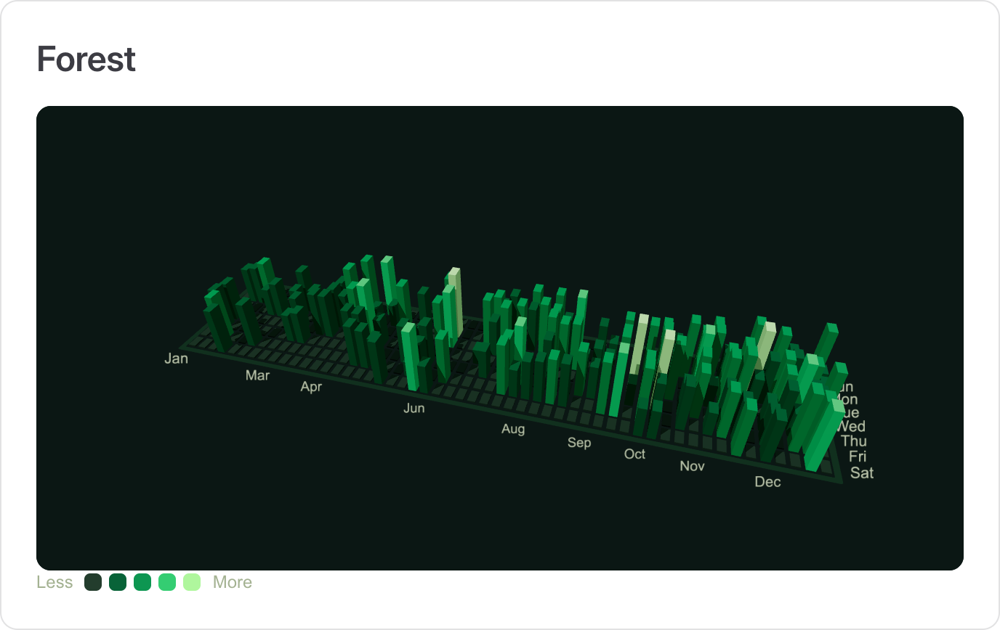
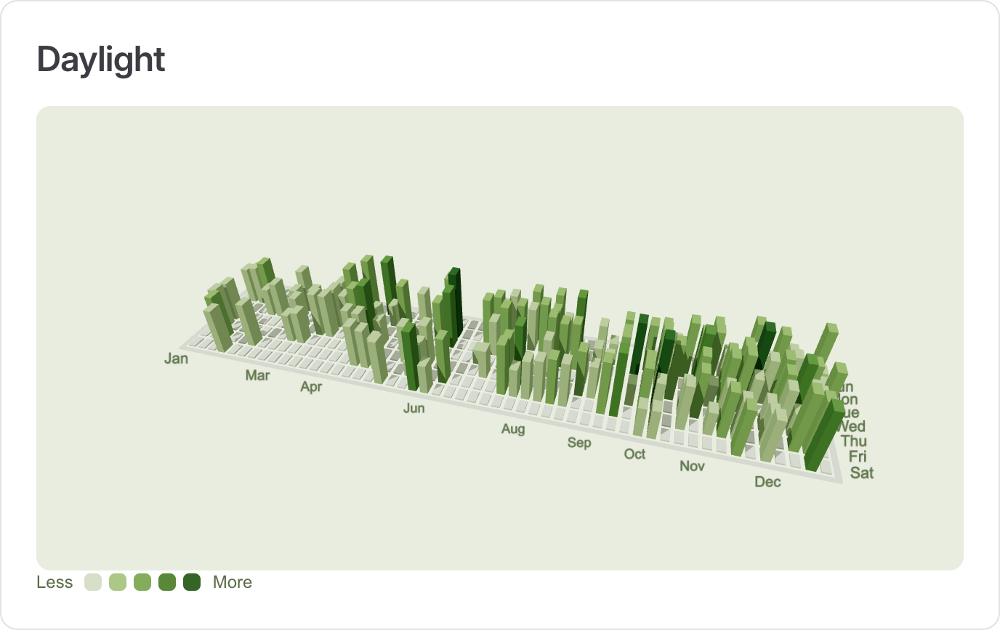
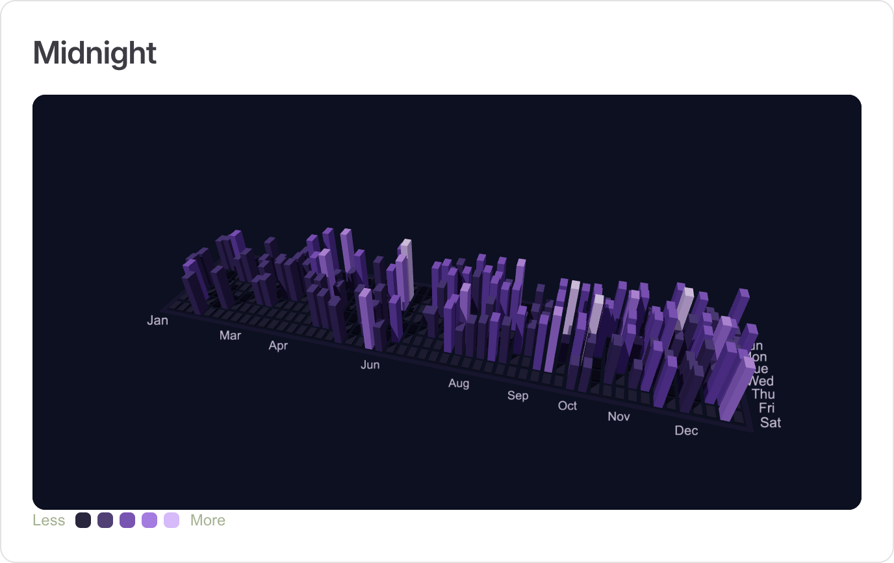

# vue-contribution-graph-3d

An interactive **3D GitHub contribution graph** for Vue 3, rendered with Three.js and styled with
Tailwind CSS.

Every day is a bar. Quiet days stay flat, busy days tower over their neighbours, and the whole grid
grows out of the ground when data arrives. Drag to orbit, scroll to zoom, hover a bar for its exact
count.

```vue
<script setup lang="ts">
import { ContributionGraph3D } from 'vue-contribution-graph-3d'
import 'vue-contribution-graph-3d/style.css'
</script>

<template>
  <ContributionGraph3D username="torvalds" palette="forest" />
</template>
```

## Component previews

The same component rendered with each built-in palette:

| Forest                                                                                              | Daylight                                                                                                  | Midnight                                                                                                  |
| --------------------------------------------------------------------------------------------------- | --------------------------------------------------------------------------------------------------------- | --------------------------------------------------------------------------------------------------------- |
| [](docs/public/previews/forest.png) | [](docs/public/previews/daylight.png) | [](docs/public/previews/midnight.png) |

Click a thumbnail for the full-size image. For interactive versions, run `npm run dev` and open
[`/guide/previews`](http://localhost:5173/guide/previews). The demos use sample data and require no GitHub access.

## Features

- 🧊 **Real 3D** — logarithmic height scale, soft shadows, per-palette scene colors, orbit
  controls and a camera that frames the grid for you.
- 🧩 **A full component suite** — graph, toolbar, legend, stats, year tabs, palette picker, user
  form and tooltip, all independently importable.
- 🌗 **Three palettes, two themes** — `forest`, `daylight` and `midnight`, with light and dark
  chrome driven by namespaced `--color-cg-*` variables.
- 📦 **No CSS surprises** — `dist/style.css` ships `@theme` tokens and utilities only. No preflight,
  no global selectors, no theme collisions.
- ⚡ **Composable data layer** — `useGitHubContributions`, `useContributionStats`,
  `useSampleContributions`, or bring your own `{ date, count }` pairs.
- ♿ **Accessible** — screen-reader axis labels, labelled controls, focus rings, and full support for
  `prefers-reduced-motion`.
- 🧹 **Disposes everything** — geometries, materials, textures, controls, observers, listeners and
  the animation frame are all released on unmount.
- 🔍 **Tree-shakeable and typed** — ES + CJS builds with generated `.d.ts` files.

## Installation

```sh
npm install vue-contribution-graph-3d three
```

```ts
import 'vue-contribution-graph-3d/style.css'
```

`vue` and `three` are peer dependencies and are never bundled.

## The component suite

| Component                       | Purpose                                 |
| ------------------------------- | --------------------------------------- |
| `<ContributionGraph3D />`       | The WebGL scene.                        |
| `<ContributionToolbar />`       | Status pill, replay and reset buttons.  |
| `<ContributionLegend />`        | Intensity swatches.                     |
| `<ContributionStats />`         | Total, active days, streak, best day.   |
| `<ContributionYearTabs />`      | `v-model` year switcher.                |
| `<ContributionPalettePicker />` | `v-model` palette switcher.             |
| `<ContributionUserForm />`      | `@username` input with a submit button. |
| `<ContributionTooltip />`       | The hover card.                         |

## Documentation

The documentation site is built with VitePress and styled with Tailwind CSS. Run it locally with:

```sh
npm install
npm run dev
```

Then open the guide, browse the component pages, or open the **playground** — it writes the exact
component code for you as you change the controls.

## Scripts

| Script               | What it does                                   |
| -------------------- | ---------------------------------------------- |
| `npm run dev`        | VitePress docs site with hot reload.           |
| `npm run build`      | Build `dist/` (ES, CJS, `.d.ts`, `style.css`). |
| `npm run typecheck`  | `vue-tsc --noEmit`.                            |
| `npm test`           | Vitest suite.                                  |
| `npm run docs:build` | Static documentation build.                    |
| `npm run format`     | Prettier.                                      |

## Requirements

- Vue `^3.4`
- Three.js `>=0.160`
- Node `>=20` to build

## License

MIT
